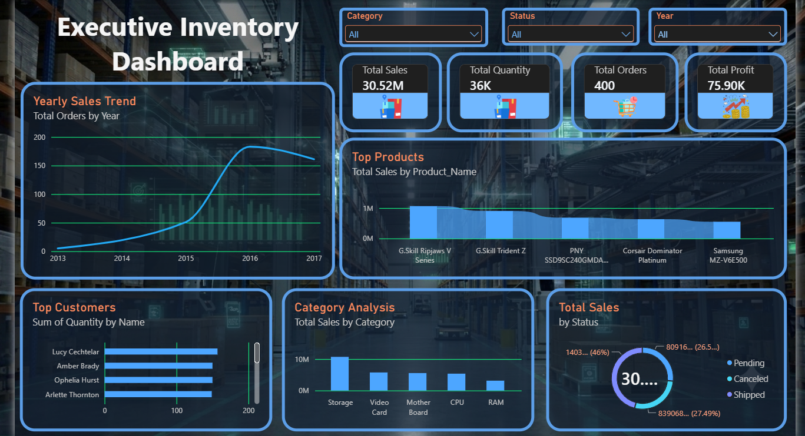
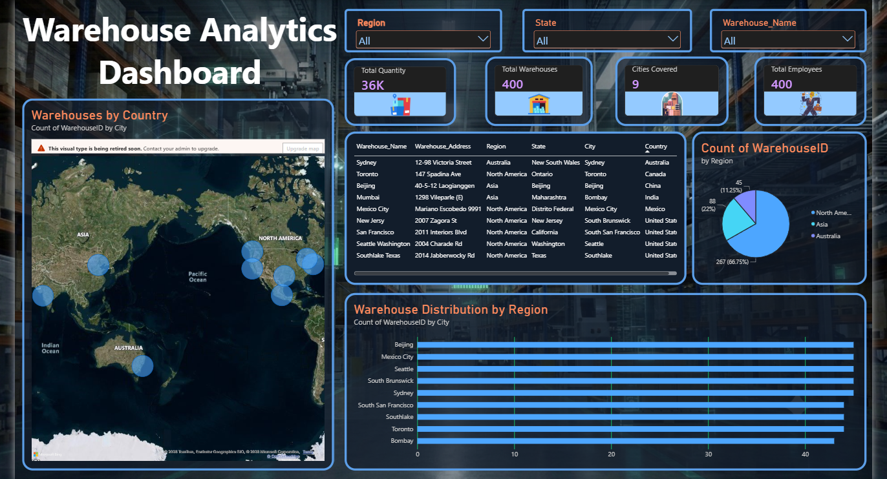
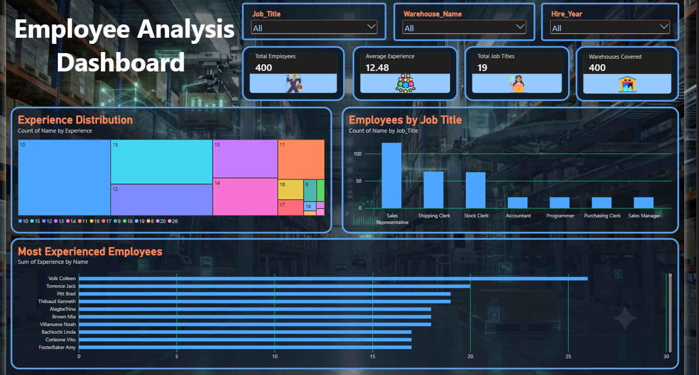

# Inventory-Management-Analytics
Power BI dashboard project for Inventory Management Analytics, focusing on inventory performance, warehouse analytics, and employee analysis.

## 📌 Project Overview

This project focuses on analyzing inventory data using Microsoft Power BI to gain insights into inventory performance, warehouse operations, and employee analysis.

The dashboard helps visualize important inventory-related information and supports better data-driven decision-making.

## 🎯 Project Objectives

- Analyze inventory performance and stock levels.
- Understand warehouse-related operations.
- Explore employee-related data and performance.
- Identify useful patterns and trends through data visualization.
- Present key information through an interactive Power BI dashboard.

## 🛠️ Tools & Technologies

- **Microsoft Power BI** – Dashboard development and data visualization
- **Power Query** – Data cleaning and transformation
- **DAX (Data Analysis Expressions)** – Calculated measures and KPIs
- **Microsoft Excel** – Data source (if applicable)

## 📊 Dashboard Pages

### 1. Executive Inventory
Provides an overview of inventory performance through key metrics, KPIs, and visualizations.

### 2. Warehouse Analytics
Focuses on warehouse-related analysis to understand inventory distribution and warehouse operations.

### 3. Employee Analysis
Presents employee-related insights through interactive visualizations and analytical metrics.

## 📸 Dashboard Preview

### 1. Executive Inventory Dashboard

## 📈 Key Performance Indicators (KPIs)

KPI Value 
Total Sales 30.52M 
Total Quantity 36K 
Total Orders 400 
Total Profit 75.90K 

These KPIs provide an overview of inventory performance and help monitor sales, order volume, quantity, and profitability.

## 🔍 Business Insights

- Analyzed yearly order trends to understand changes in business performance.
- Identified top-performing products based on total sales.
- Monitored sales, quantity, orders, and profitability through KPI cards.
- Enabled dynamic analysis using category, status, and year filters.
- Provided a centralized view of inventory, warehouse operations, and employee-related information.

### 2. Warehouse Analytics Dashboard

### 🏭 Warehouse Analytics – Key Performance Indicators

KPI Value 
Total Quantity 36K 
Total Warehouses (Reported Count) 400 
Cities Covered 9 
Total Employees 400

### Key Business Insights

- North America accounts for the highest proportion of warehouse records at 66.75%, followed by Asia at 22% and Australia at 11.25%.
- The warehouse network covers 9 cities across three geographical regions.
- Geographical map visualization helps understand warehouse locations and distribution.
- City-wise warehouse analysis helps compare the distribution of warehouse records across different locations.
- Interactive filters for region, state, and warehouse name enable detailed warehouse analysis.
- The dashboard provides a centralized view of warehouse distribution, inventory quantity, and workforce information.54b

### 3. Employee Analysis Dashboard

### 👥 Employee Analysis – Key Performance Indicators

| KPI | Value |
|---|---:|
| Total Employees | 400 |
| Average Experience | 12.48 Years |
| Total Job Titles | 19 |
| Warehouses Covered (Reported Count) | 400 |

### Key Business Insights

- The dataset contains 400 employees across 19 different job titles.
- Employees have an average experience of 12.48 years, indicating an experienced workforce.
- Sales Representative is the most represented job role, followed by Shipping Clerk and Stock Clerk.
- The largest employee experience group has 10 years of experience.
- The highest displayed employee experience is 26 years.
- Interactive filters based on job title, warehouse name, and hiring year allow detailed workforce analysis.
- The dashboard helps understand workforce distribution, employee experience, and staffing patterns.

## 💡 Key Learnings

- Developed an interactive dashboard using Power BI.
- Practiced data cleaning and transformation.
- Created calculated measures using DAX.
- Improved data visualization and analytical skills.
- Learned how to present business data in a meaningful way.

## 📁 Project Files

| File | Description |
|---|---|
| `Inventory Management Analysis.pbix` | Power BI dashboard project |
| `screenshots/` | Dashboard preview images |

## 🚀 How to View the Project

1. Download the `.pbix` file from this repository.
2. Open it using Microsoft Power BI Desktop.
3. Explore the dashboard pages and interactive visualizations.

## 👨‍💻 Author

**Raj Singh**

*Power BI | Data Analytics | Data Visualization*
